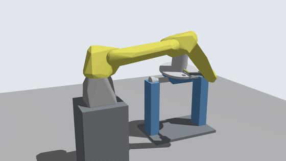
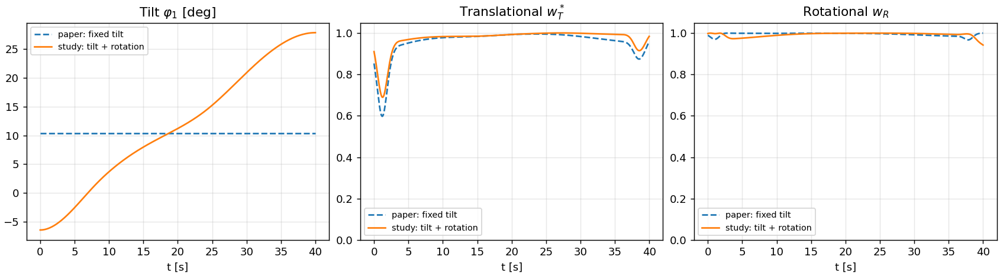

# Welding Robot and 2-DOF Positioner: Gazebo Simulation

Gazebo simulation based on the paper *Optimal Motions of a Welding Robot for Cooperative Tasks with a 2 DOF Positioner* (COMRob 2021). A Fanuc ARC Mate 100iC robot applies a helical welding seam on a pipe while a 2-DOF tilt-rotate positioner turns the pipe. Both machines move at the same time, and the motions are chosen so that the robot keeps good translational and rotational manipulability during the whole task.

The repository also includes a study that is not in the paper: the tilt axis of the positioner moves too, see [Study: both axes of the positioner](#study-both-axes-of-the-positioner).



The simulation uses ROS 2 Jazzy and Gazebo Harmonic. A Python planner computes the trajectories from the equations of the paper, and a ROS node plays them in Gazebo.

## What you need

- A computer with **Ubuntu 24.04**, because ROS 2 Jazzy needs it.
- About 10 GB of free disk space. No special GPU is needed.

You do not need to know ROS or Python to run it. Copy each block into a terminal (`Ctrl+Alt+T` opens one) and press Enter.

## Installation

**1. Download the repository**

```bash
sudo apt update && sudo apt install -y git
mkdir -p ~/ws_comrob2021/src
cd ~/ws_comrob2021/src
git clone https://github.com/juliordzcer/welding-robot-positioner.git
```

**2. Install ROS 2, Gazebo and the other dependencies**

This asks for your password and takes a while.

```bash
cd ~/ws_comrob2021/src/welding-robot-positioner
./install_deps.sh
```

**3. Build**

```bash
source /opt/ros/jazzy/setup.bash
cd ~/ws_comrob2021
colcon build --symlink-install
```

It should end with `1 package finished`.

**4. Prepare each new terminal**

```bash
source /opt/ros/jazzy/setup.bash
source ~/ws_comrob2021/install/setup.bash
```

## Running the simulation

```bash
ros2 launch comrob2021_welding welding.launch.py
```

Gazebo opens after a few seconds. The first time it also downloads some free models of the cell (shelves, pallets, a cabinet) from [Gazebo Fuel](https://app.gazebosim.org), so it needs internet. After 3 s the task starts: the positioner turns the pipe one full turn in 40 s while the torch follows the white chalk line, and the weld bead grows behind the arc.

A small **Welding task** window shows the time, the angles of the positioner, the manipulabilities and the gap between the torch and the chuck. When the task ends, it shows the results (objective f of eq. 24, lowest and mean manipulabilities, smallest gap), and the terminal prints them too. Press **Restart** to run the task again, or from another terminal:

```bash
ros2 service call /welding/restart std_srvs/srv/Trigger
```

To close everything, press `Ctrl+C` in the terminal. If Gazebo behaves strangely, check that no other simulation is open: `pkill -f "gz sim"` closes them.

| Argument | Values | Default | What it does |
|---|---|---|---|
| `mode` | `paper`, `two_axis` | `paper` | Trajectories of the paper, or of the study with both positioner axes |
| `gui` | `true`, `false` | `true` | Show the Gazebo window |
| `loop` | `true`, `false` | `false` | Repeat the task by itself when it ends |
| `panel` | `true`, `false` | `true` | Show the Welding task window |
| `bead` | `true`, `false` | `true` | Draw the weld bead and the arc |
| `rviz` | `true`, `false` | `false` | Also open RViz |

For example, the study with both axes:

```bash
ros2 launch comrob2021_welding welding.launch.py mode:=two_axis
```

## Computing the trajectories again

The file `config/trajectory.csv` is already included. To compute it again from the equations of the paper and make the figure below:

```bash
cd ~/ws_comrob2021/src/welding-robot-positioner
python3 -m comrob2021_welding.planner config/
python3 -m comrob2021_welding.plots config/trajectory.csv media/results.png
cd ~/ws_comrob2021 && colcon build --symlink-install
```


## Study: both axes of the positioner

In the paper only the rotation of the positioner (φ₂) moves. The tilt φ₁ stays at 10.4° during the whole task, because the paper found that moving it is not needed. This study checks what happens if the tilt also moves.

The tilt φ₁(t) is a smooth curve through six values, at t = 0, 8, 16, 24, 32 and 40 s, with zero speed at the start and at the end. The six values are chosen by an optimizer (Nelder-Mead) that minimizes the same objective of the paper, equation (24), with the same φ₂(t) and ψ(t). The tilt is limited to ±45°, and a tilt is rejected if the torch gets closer than 10 mm to the faceplate or the chuck.

| | Paper (fixed tilt) | Study (tilt + rotation) |
|---|---|---|
| Objective f, eq. (24) | −0.884 | −0.917 |
| Lowest w_T* | 0.60 | 0.69 |
| Lowest w_R | 0.97 | 0.94 |



Moving the tilt improves the translational manipulability at the start of the task, where the paper has its lowest value, and costs a little rotational manipulability. The tilt goes from −6° to 28°. To compute it again (about 1 minute):

```bash
python3 -m comrob2021_welding.planner config/ two_axis
python3 -m comrob2021_welding.plots compare
```

## How it works

`comrob2021_welding/planner.py` follows Sections II to IV of the paper:

1. **Models.** The robot and the positioner use the modified Denavit-Hartenberg parameters of Tables I and II, and the torch and the placement of both machines use equations (1) to (4).
2. **Task.** The seam is one turn of a helix of radius 100 mm and height 450 mm, done in 40 s at constant speed, with the torch normal to the cylinder (equations 16 to 23).
3. **Positioner and torch.** The positioner angle φ₂(t) and the torch angle ψ(t) are the time functions of equations (26) to (28) with Tables III and IV. The tilt of the table stays at φ₁ = 10.4°.
4. **Robot.** For each instant, equation (7) gives the pose that the robot must reach, and numerical inverse kinematics gives its six joints.
5. **Performance.** The translational and rotational manipulabilities (equations 11 to 15) are computed along the task, together with the gap between the torch and the chuck.

The ROS node `trajectory_player.py` reads the trajectory file and sends one position command per joint to Gazebo at 100 Hz, through `ros_gz_bridge`. Gazebo publishes the joint states back, so `robot_state_publisher` and RViz show the same motion. The same node draws the weld bead with Gazebo markers (`comrob2021_welding/bead.py`): a tube along the part of the seam already welded, which turns with the pipe, with its last part glowing and a flickering arc at the torch tip.

## Differences from the paper

- **Inverse kinematics.** The paper uses Paul's method. Here a numerical method (damped least squares) is used, starting from the best posture at t = 0.
- **Height of the seam.** The paper does not give where the workpiece sits on the table (the matrix ᵐ²T_k). If the seam starts on the faceplate, the torch hits the chuck (up to 106 mm of overlap). Here the seam starts 150 mm above the faceplate, on a longer pipe, and the planner checks along the whole task that the wrist and the torch stay away from the faceplate and the chuck: the smallest gap is 59 mm. The column `clearance` of the trajectory files has this gap.
- **Rotational manipulability** stays near 1, as in the paper. The **translational manipulability** is near 1 most of the time, but it drops to 0.60 during the first 3 s, when ψ changes from 40° to −18.4°. The paper does not give the exact torch matrix and the frame of the workpiece, so they were assumed and may be the reason.
- **Robot model.** The meshes are from the ROS-Industrial model of the Fanuc M-10iA, which is the same arm as the ARC Mate 100iC. The positioner is my own design, in the style of industrial single-sided tilt-rotate positioners, with the kinematics of Table II. The torch and the pipe are simple shapes with the dimensions of the paper.
- **Weld bead.** It is only a drawing. Gazebo does not simulate the welding process.
- **No dynamics.** Gazebo has no gravity here and moves the joints to the planned positions. It shows the kinematics of the task, not the forces.

## Files

| Path | Content |
|---|---|
| `comrob2021_welding/planner.py` | Kinematic models, time functions, inverse kinematics and manipulabilities |
| `comrob2021_welding/plots.py` | Figures of the trajectories, manipulabilities and the study |
| `comrob2021_welding/bead.py` | Weld bead and arc drawn with Gazebo markers |
| `scripts/gen_urdf.py` | Writes `urdf/welding_cell.urdf` (robot, torch, positioner and pipe) |
| `nodes/trajectory_player.py` | ROS 2 node that plays the trajectories in Gazebo and reports the results |
| `nodes/control_panel.py` | Welding task window with the results and the Restart button |
| `launch/welding.launch.py` | Starts Gazebo, the bridge and the nodes |
| `urdf/welding_cell.urdf` | Robot, torch, positioner and workpiece |
| `worlds/welding_cell.sdf` | Gazebo world |
| `config/trajectory.csv` | Planned trajectories of the paper (40 s, 801 samples) |
| `config/trajectory_two_axis.csv` | Planned trajectories of the study with both axes |

## Citation

If you use this simulation, please cite the paper:

```bibtex
@inproceedings{santellano2021optimal,
  title     = {Optimal Motions of a Welding Robot for Cooperative Tasks with a 2 {DOF} Positioner},
  author    = {Santellano, O. I. and P{\'a}manes, J. A. and Rodr{\'i}guez, J. C. and P{\'a}manes, J. J.},
  booktitle = {2021 XXIII Robotics Mexican Congress (ComRob)},
  pages     = {145--151},
  year      = {2021},
  address   = {Tijuana, Baja California, M{\'e}xico}
}
```

Paper: [IEEE Xplore](https://ieeexplore.ieee.org/document/9628721) · [PDF](https://juliordz.com/papers/comrob2021.pdf)

## License

Apache License 2.0, see `LICENSE`. The meshes of the robot are from [ROS-Industrial](https://github.com/ros-industrial/fanuc) (BSD-3-Clause), see `NOTICE`. The models of the cell are downloaded from Gazebo Fuel, with their own licenses.

## Troubleshooting

- **The bead does not appear.** It is drawn in the Gazebo window and in camera sensors only. Check that `bead:=true`.
- **Gazebo is very slow with `gui:=false` on a laptop with an NVIDIA card.** Gazebo may render with the CPU. Run `export __EGL_VENDOR_LIBRARY_FILENAMES=/usr/share/glvnd/egl_vendor.d/10_nvidia.json` before launching.
