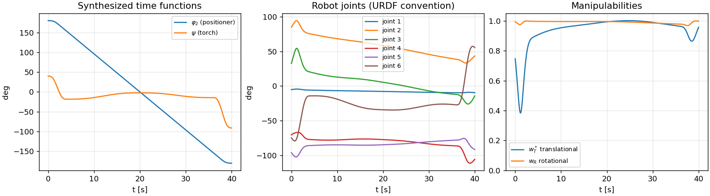

# Welding Robot and 2-DOF Positioner: Gazebo Simulation

Gazebo simulation based on the paper *Optimal Motions of a Welding Robot for Cooperative Tasks with a 2 DOF Positioner* (COMRob 2021). A Fanuc ARC Mate 100iC robot applies a helical welding seam on a cylinder while a 2-DOF positioner table rotates the workpiece. Both machines move at the same time, and the motions are chosen so that the robot keeps good translational and rotational manipulability during the whole task.


The simulation uses ROS 2 Jazzy and Gazebo Harmonic. A Python planner computes the trajectories from the equations of the paper, and a ROS node plays them in Gazebo.

## What you need

- A computer with **Ubuntu 24.04**, because ROS 2 Jazzy needs it.
- About 10 GB of free disk space. No special GPU is needed.

You do not need to know ROS or Python to run it. Copy each block into a terminal (`Ctrl+Alt+T` opens one) and press Enter.

## Installation

**1. Download the repository**

```bash
sudo apt update && sudo apt install -y git
mkdir -p ~/ws_comrob2021/src
cd ~/ws_comrob2021/src
git clone https://github.com/juliordzcer/welding-robot-positioner.git
```

**2. Install ROS 2, Gazebo and the other dependencies**

This asks for your password and takes a while.

```bash
cd ~/ws_comrob2021/src/welding-robot-positioner
./install_deps.sh
```

**3. Build**

```bash
source /opt/ros/jazzy/setup.bash
cd ~/ws_comrob2021
colcon build --symlink-install
```

It should end with `1 package finished`.

**4. Prepare each new terminal**

```bash
source /opt/ros/jazzy/setup.bash
source ~/ws_comrob2021/install/setup.bash
```

## Running the simulation

```bash
ros2 launch comrob2021_welding welding.launch.py
```

Gazebo opens after a few seconds. After 3 s the task starts: the positioner turns the cylinder one full turn in 40 s while the torch follows the red seam. When it ends, it waits 2 s and starts again. To close everything, press `Ctrl+C` in the terminal.

| Argument | Values | Default | What it does |
|---|---|---|---|
| `gui` | `true`, `false` | `true` | Show the Gazebo window |
| `loop` | `true`, `false` | `true` | Repeat the task when it ends |
| `rviz` | `true`, `false` | `false` | Also open RViz |

## Computing the trajectories again

The file `config/trajectory.csv` is already included. To compute it again from the equations of the paper and make the figure below:

```bash
cd ~/ws_comrob2021/src/welding-robot-positioner
python3 -m comrob2021_welding.planner config/
python3 -m comrob2021_welding.plots config/trajectory.csv media/results.png
cd ~/ws_comrob2021 && colcon build --symlink-install
```



## How it works

`comrob2021_welding/planner.py` follows Sections II to IV of the paper:

1. **Models.** The robot and the positioner use the modified Denavit-Hartenberg parameters of Tables I and II, and the torch and the placement of both machines use equations (1) to (4).
2. **Task.** The seam is one turn of a helix of radius 100 mm and height 450 mm, done in 40 s at constant speed, with the torch normal to the cylinder (equations 16 to 23).
3. **Positioner and torch.** The positioner angle φ₂(t) and the torch angle ψ(t) are the time functions of equations (26) to (28) with Tables III and IV. The tilt of the table stays at φ₁ = 10.4°.
4. **Robot.** For each instant, equation (7) gives the pose that the robot must reach, and numerical inverse kinematics gives its six joints.
5. **Performance.** The translational and rotational manipulabilities (equations 11 to 15) are computed along the task.

The ROS node `trajectory_player.py` reads `config/trajectory.csv` and sends one position command per joint to Gazebo at 100 Hz, through `ros_gz_bridge`. Gazebo publishes the joint states back, so `robot_state_publisher` and RViz show the same motion.

## Differences from the paper

- **Inverse kinematics.** The paper uses Paul's method. Here a numerical method (damped least squares) is used, starting from the best posture at t = 0.
- **Rotational manipulability** stays near 1, as in the paper. The **translational manipulability** is near 1 most of the time, but it drops during the first 3 s, when ψ changes from 40° to −18.4°. The paper does not give the frame of the workpiece on the table or the exact torch matrix, so they were assumed and may be the reason.
- **Robot model.** The meshes are from the ROS-Industrial model of the Fanuc M-10iA, which is the same arm as the ARC Mate 100iC. The positioner, the torch and the workpiece are simple shapes with the dimensions of the paper.
- **No dynamics.** Gazebo has no gravity here and moves the joints to the planned positions. It shows the kinematics of the task, not the forces.

## Files

| Path | Content |
|---|---|
| `comrob2021_welding/planner.py` | Kinematic models, time functions, inverse kinematics and manipulabilities |
| `comrob2021_welding/plots.py` | Figure of the trajectories and manipulabilities |
| `nodes/trajectory_player.py` | ROS 2 node that plays the trajectories in Gazebo |
| `launch/welding.launch.py` | Starts Gazebo, the bridge and the nodes |
| `urdf/welding_cell.urdf` | Robot, torch, positioner and workpiece |
| `worlds/welding_cell.sdf` | Gazebo world |
| `config/trajectory.csv` | Planned trajectories (40 s, 801 samples) |

## Citation

If you use this simulation, please cite the paper:

```bibtex
@inproceedings{santellano2021optimal,
  title     = {Optimal Motions of a Welding Robot for Cooperative Tasks with a 2 {DOF} Positioner},
  author    = {Santellano, O. I. and P{\'a}manes, J. A. and Rodr{\'i}guez, J. C. and P{\'a}manes, J. J.},
  booktitle = {2021 XXIII Robotics Mexican Congress (ComRob)},
  pages     = {145--151},
  year      = {2021},
  address   = {Tijuana, Baja California, M{\'e}xico}
}
```

Paper: [IEEE Xplore](https://ieeexplore.ieee.org/document/9628721) · [PDF](https://juliordz.com/papers/comrob2021.pdf)

## License

Apache License 2.0, see `LICENSE`. The meshes of the robot are from [ROS-Industrial](https://github.com/ros-industrial/fanuc) (BSD-3-Clause), see `NOTICE`.
